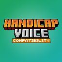

<p align="center">
  
</p>

<h1 align="center">Handicap Voice Compat</h1>

<p align="center">
  Makes the <b>Mute</b>, <b>Deaf</b> and <b>Partial Deafness</b> handicaps from <b>Handicap</b> work in <b>Simple Voice Chat</b>.<br>
  Fabric · Minecraft 26.2 · MIT
</p>

---

## Why

Handicap only affects the text chat and the game sounds. Without this addon, a mute player can still talk in voice chat, and a deaf player still hears everyone perfectly. This addon makes voice chat follow your handicaps.

## Features

| Handicap | What happens in Simple Voice Chat |
|---|---|
| **Mute** | The player's voice is heavily muffled and garbled before it is sent: others hear sounds but can't understand them. The player gets no message or warning about it. |
| **Deaf** | The player notices that someone is talking (a faint, muffled rumble) but can't understand the words. |
| **Partial Deafness** | Voices are quieter and muffled, as if heard through a wall, but still mostly understandable. |

- **Effects stack:** a mute player heard by a deaf player goes through both filters.
- **Works everywhere** in Simple Voice Chat: proximity, whispering, groups, and audio from other voice chat addons.
- **Deaf overrides Partial Deafness** when a player has both, the same way Handicap handles game sounds.
- **Server-controlled config**, sent to every player who joins, so players can't weaken the effects.

## Installation

Put the mod in the `mods/` folder of **both the client and the server**, together with its dependencies:

| Dependency | |
|---|---|
| Minecraft **26.2** + [Fabric Loader](https://fabricmc.net/) | Required |
| Fabric API | Required |
| Handicap | Required |
| Simple Voice Chat | Required |
| Cloth Config API | Required |
| Mod Menu | Optional, adds the in-game config screen |

Java 25 is required, as for Minecraft 26.2.

Tested with Handicap 1.4.0, Simple Voice Chat 2.6.27 and Cloth Config 26.2.155.

## Configuration

The config file is `config/handicapvoice.toml`. It has one section per handicap, and each section has three values from `0.0` to `1.0`:

| Setting | Meaning |
|---|---|
| `volume` | 1 = unchanged, 0 = silent |
| `muffle` | 0 = clear, 1 = only a low rumble remains |
| `distortion` | 0 = clean, 1 = unintelligible |

Default file:

```toml
# Alters what a mute player sends in Simple Voice Chat.
[mute]
volume = 0.7
muffle = 0.9
distortion = 0.85

# Alters what a deaf player hears in Simple Voice Chat.
[deaf]
volume = 0.3
muffle = 0.95
distortion = 0.2

# Alters what a partially deaf player hears in Simple Voice Chat.
[partialDeafness]
volume = 0.2
muffle = 0.6
distortion = 0.0
```

(The real file also has a comment above every value.)

- A value outside `0.0 - 1.0` is reset to its default, with a warning in the log.
- A missing key keeps its default. The file is rewritten on startup with every key and comment.
- **Dedicated server:** edit the file, then restart the server.
- **Singleplayer / LAN:** with Mod Menu, open *Mods → Handicap Voice Compat → Configure*. Saving applies the change immediately to every connected player.
- **On a multiplayer client**, the local file and screen have no effect: the server's values always win.

## How it works

Handicap syncs each player's handicaps to their client. This addon registers a Simple Voice Chat plugin that reads that state on the client:

- **Mute:** the microphone audio is filtered *before* it is encoded and sent (`ClientSoundEvent`).
- **Deaf / Partial Deafness:** every incoming audio stream is filtered *before* it is played (`ClientReceiveSoundEvent`, for entity, locational and static sounds).

The filter ([`VoiceFilter`](src/main/java/com/handicapvoice/VoiceFilter.java)) processes 48 kHz PCM frames in this order:

1. **Distortion:** sample-and-hold, ring modulation and overdrive.
2. **Muffle:** a 4-stage low-pass filter, from 8 kHz down to 120 Hz.
3. **Volume:** gain.

Each audio stream keeps its own filter state, so there are no clicks between frames.

> Because the audio is processed on the player's own computer, a deliberately modified client could skip it. Normal players can't turn it off, and the strength of every effect is decided by the server.

## Building from source

Requirements:

- **JDK 25**
- The **Handicap** jar. Handicap is not published on any Maven repository, so you have to build it yourself.

Steps:

1. Build Handicap from its sources:
   ```sh
   ./gradlew :fabric:build
   ```
2. Point `handicap_jar` in [`gradle.properties`](gradle.properties) to the resulting jar. The default is `.SourcesMods/Handicap-26.2/Handicap-26.2/fabric/build/libs/handicap-fabric-1.4.0+mc26.2.jar`, and `.SourcesMods/` is git-ignored.
3. Build this mod:
   ```sh
   ./gradlew build
   ```
   The mod is `build/libs/handicapvoice-fabric-<version>.jar`. The `-sources.jar` next to it only contains the source code and is not needed to play.

To test in a development game, which already includes Handicap, Simple Voice Chat, Cloth Config and Mod Menu:

```sh
./gradlew runClient
./gradlew runServer
```

The Simple Voice Chat API comes from `maven.maxhenkel.de`. Handicap and Simple Voice Chat are **compile-only** dependencies: neither is ever bundled into this mod's jar.

### Project layout

```
src/main/java/com/handicapvoice/
├── HandicapVoice.java            mod entrypoint: config loading and syncing to clients
├── HandicapVoicePlugin.java      Simple Voice Chat plugin: mic and incoming audio hooks
├── VoiceFilter.java              audio filter (distortion, muffle, volume)
├── Config.java                   AutoConfig definition and validation
├── CommentedTomlSerializer.java  commented TOML read/write
├── VoiceConfig.java              defaults and the config received from the server
├── VoiceProfile.java             volume / muffle / distortion for one handicap
└── ConfigPayload.java            server → client config packet
src/client/java/com/handicapvoice/client/
├── HandicapVoiceClient.java      receives the config packet
└── HandicapVoiceModMenu.java     Mod Menu config screen
```

## Credits

- **Handicap** by FERSPI (LGPLv3)
- **Simple Voice Chat** by Max Henkel

This is an **unofficial addon**, not affiliated with either mod. It contains no code from Handicap or Simple Voice Chat: it only uses their public interfaces.

## License

[MIT](LICENSE) © 2026 Heet
